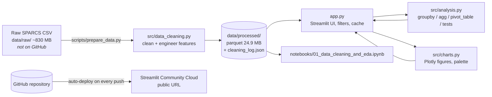

# 🏥 MediScope – Hospital Inpatient Discharges Dashboard (New York, 2021)

An interactive **Streamlit** dashboard that analyses **2.1 million hospital stays** from New York State's SPARCS database. It helps hospital administrators, clinicians and operations managers plan beds, control costs and compare hospitals fairly.

### 🔗 Live app: **https://YOUR-APP-NAME.streamlit.app**
> ⚠️ Replace the link above with your own Streamlit Cloud URL after deploying (see [Deployment](#8-deployment-streamlit-community-cloud)).

| | |
|---|---|
| **Assessment** | Mathematics for AI-II – Summative Assessment, **Scenario 2: Hospital Inpatient Discharges Dashboard** |
| **CRS** | Artificial Intelligence |
| **Student** | Shivam Bhuva (student ID 2505469) |
| **Candidate registration number** | *add yours* |
| **School** | *add your school* |
| **Repository** | [Shivamm638/IDAI107-2505469---Shivam_Bhuva](https://github.com/Shivamm638/IDAI107-2505469---Shivam_Bhuva) |


---

## Contents
1. [Project overview](#1-project-overview)
2. [Key features](#2-key-features)
3. [Research questions and key findings](#3-research-questions-and-key-findings)
4. [Data and cleaning](#4-data-and-cleaning)
5. [Integration details](#5-integration-details)
6. [Repository structure](#6-repository-structure)
7. [Run it locally](#7-run-it-locally)
8. [Deployment (Streamlit Community Cloud)](#8-deployment-streamlit-community-cloud)
9. [Screenshots](#9-screenshots)
10. [Limitations](#10-limitations)
11. [References](#11-references)

---

## 1. Project overview

**Scenario.** MediScope Health Analytics works with hospitals to improve patient care and operations. As a data analyst, the task is to study inpatient discharges: admission and discharge trends, length-of-stay patterns, the departments and conditions that drive cost, and how payers differ. The results go into an interactive dashboard for decision-makers.

**What the dashboard analyses**

- **Length of stay (LOS):** which diagnoses, departments, counties and hospitals keep patients longest, and how many bed-days each condition uses.
- **Cost and severity:** how APR-DRG severity of illness, age and gender drive total charges, including outliers and the cost of each extra day.
- **Payers and billing:** payer mix, billed charges vs. estimated costs (mark-up), regional price differences, and payer comparisons at equal severity.
- **Hospital benchmarking:** a case-mix-adjusted length-of-stay index (observed ÷ expected for the same diagnosis and severity).

The project follows the five assessment steps:

| Step | Where |
|---|---|
| 1. Understand the problem & research | [`docs/research_questions.md`](docs/research_questions.md) |
| 2. Data preprocessing & cleaning | [`src/data_cleaning.py`](src/data_cleaning.py), run by [`scripts/prepare_data.py`](scripts/prepare_data.py) |
| 3. Exploratory data analysis | [`notebooks/01_data_cleaning_and_eda.ipynb`](notebooks/01_data_cleaning_and_eda.ipynb), [`src/analysis.py`](src/analysis.py) |
| 4. Interactive visualisations | [`src/charts.py`](src/charts.py), [`app.py`](app.py) |
| 5. GitHub & Streamlit deployment | this README, [`requirements.txt`](requirements.txt), [`.streamlit/config.toml`](.streamlit/config.toml) |

## 2. Key features

- **8 sidebar filters:** service area, county (narrows to the chosen areas), age group, gender, severity, admission type, diagnosis category and payment type. There's also a toggle that hides extreme-charge outliers. Every KPI, chart and research-question answer updates together.
- **6 KPI tiles:** discharges, average stay, median charge, total billed, mark-up and mortality. When filters are on, each tile shows the difference from the New York average.
- **10 interactive Plotly charts**, all with hover tooltips, zoom and PNG export:

  | # | Chart | Tab | Question |
  |---|---|---|---|
  | 1 | **Histogram** – distribution of length of stay (split by severity or admission type, mean and median marked) | Overview | Q1 |
  | 2 | **Pie (donut)** – patients by payment type | Overview | Q5 |
  | 3 | **Bar** – average/median stay per diagnosis code, body system or department | Length of stay | Q1 |
  | 4 | **Heatmap** – average stay by county or hospital × severity, coloured against each column's average | Length of stay | Q4 |
  | 5 | **Box plot** – total charges by severity (exact quartiles from all 2.1M rows, Tukey whiskers, log or linear scale) | Cost & severity | Q3 |
  | 6 | Grouped bar – charges by age group × gender | Cost & severity | Q2 |
  | 7 | Bar + markers – billed charge vs. estimated cost by payer | Payers & billing | Q5 |
  | 8 | Line – payer comparison within each severity level (Simpson's paradox) | Payers & billing | Q5 |
  | 9 | Heatmap – `pivot_table` of service area × payer (charge, stay or mark-up) | Payers & billing | Q5 |
  | 10 | Bubble scatter – hospitals: LOS index vs. median charge, bubble = volume | Hospitals | Q4 |

- **Insights tab:** written answers to the five research questions that update with the filters, five recommendations, and a statistical-evidence table (Spearman ρ, OLS regression, Kruskal–Wallis with η² effect sizes).
- **Data & methods tab:** the full cleaning log, the dropped columns and the reasons for dropping them, the engineered features, a preview of the filtered records and a CSV download.
- **Accessible design:** every chart has a "View the data behind this chart" table. Light and dark themes share a colour-blind-checked palette, and each identity has a fixed colour (Medicare is always blue).
- **Fast:** the cleaned data loads once and is cached. Only the visible tab computes, and results are cached per filter combination.

## 3. Research questions and key findings

Full background research: [`docs/research_questions.md`](docs/research_questions.md). Statewide figures, 2021:

| # | Question | Key finding |
|---|---|---|
| Q1 | Which diagnosis codes are linked to long stays? | Rare complex conditions stay longest (spinal-cord injury rehab 27.6 d, very premature newborns 27.5 d, acute myeloid leukaemia 22.9 d). Among common diagnoses, **schizophrenia** is longest (16.4 d). By bed-days, **septicemia (11.1%) and COVID-19 (5.9%)** dominate. |
| Q2 | Which age groups incur the highest charges? | The median bill climbs with age, from **$15.6k (0–17) to $53.4k (70+)**, 3.4×. Men aged 18–29 are billed 32% more than women, largely because 64% of young women's stays are childbirth. |
| Q3 | How does severity affect total cost? | The median bill goes **$24.5k → $35.8k → $55.8k → $113.3k** from Minor to Extreme (4.6×). Spearman ρ = 0.41 for charges and 0.48 for stay. Each extra day adds about **$12k** (OLS, R² = 0.46). |
| Q4 | Are there counties with longer average stays? | **Westchester** has the longest stays among the busiest counties (6.7 d vs 5.1 in Warren). It is 16–39% above average for Minor, Moderate and Major patients, so sicker patients don't explain the gap. |
| Q5 | How do payment types affect the final billing? | Medicare (39%) and Medicaid (31%) pay for 70% of stays. Medicare's median bill is highest ($52.3k vs $29.5k), but **within each severity level the ranking flips** (Simpson's paradox): payer mostly reflects age and severity. Downstate hospitals bill 2–3× upstate for the same payer, mainly through **mark-up (4.2× vs 2.6×)**. |

## 4. Data and cleaning

**Source:** [Hospital Inpatient Discharges (SPARCS De-Identified): 2021](https://health.data.ny.gov/Health/Hospital-Inpatient-Discharges-SPARCS-De-Identified/tg3i-cinn), New York State Department of Health. One row per inpatient stay; 2,101,588 rows × 33 columns (~830 MB CSV).

**Cleaning pipeline** (`src/data_cleaning.py`). Every rule is logged with the rows it removed or changed:

| Step | Rule | Effect |
|---|---|---|
| Load | `pandas.read_csv` (pyarrow engine, text as categories) | 2.1M rows in ~0.4 GB of memory |
| Duplicates | 7,104 identical rows **kept** | No patient ID exists; half are newborns billed at a flat rate, so they are different patients |
| Columns | 11 columns dropped | Birth weight (90% empty), secondary payers (51–84% empty), administrative or constant fields |
| Ungroupable | Severity code 0 or no diagnosis | −2,551 rows |
| Length of stay | Text → integer; `"120 +"` → 120 with a `los_capped` flag; must be ≥ 1 day | 1,554 values changed; no negative or zero stays found |
| Money | `"61,665.22"` → 61665.22 (float) | Charges and costs converted |
| Implausible bills | Charges under $100 | −37 rows |
| Contradictions | "Newborn" admissions recorded as adults | −33 rows |
| Categories | Gender, ethnicity, ordered age and severity scales; redacted hospitals → "Redacted" | 10,629 confidential stays kept in state totals |
| Locations | A hospital recorded in two counties → its main county | 208 values fixed |
| Diagnosis codes | CCSR prefix → 20 readable body systems; sentence-case labels; department names | 477 codes mapped |
| **Result** | | **2,098,967 clean rows (99.88% kept)** |

**Engineered features:** `dx_category`, `department`, `los_band`, `los_capped`, `charge_per_day`, `cost_per_day`, `charge_to_cost_ratio` (mark-up), `expected_los` (statewide mean for the same diagnosis and severity, the case-mix benchmark), `region`, `disposition_group`, `died_in_hospital`, `charge_outlier` (Tukey 1.5 × IQR on log charges within each severity level).

The cleaned data ships as a compressed Parquet file (`data/processed/discharges_2021_clean.parquet`, 24.9 MB), so the app needs no raw download.

## 5. Integration details



- **`app.py`** is the entry point. It loads the Parquet file once (`st.cache_resource`), reads the sidebar filters, and only renders the open tab (`st.tabs(..., on_change="rerun")`). Each analysis result is cached per filter combination (`st.cache_data`).
- **`src/analysis.py`** holds pure pandas/SciPy functions. Each takes the filtered DataFrame and returns a small table. The app and the notebook share them, so the numbers always match.
- **`src/charts.py`** turns those tables into Plotly figures using one palette for light and dark themes.
- **`src/config.py`** holds file paths, the column renames and the lookup tables (CCSR body systems, departments, regions).
- **Streamlit Community Cloud** installs `requirements.txt`, runs `app.py`, and redeploys automatically when the GitHub repo changes.

## 6. Repository structure

```
├── app.py                          # Streamlit dashboard (entry point)
├── requirements.txt                # Python packages for Streamlit Cloud
├── README.md
├── .streamlit/config.toml          # light/dark theme and chart colours
├── src/
│   ├── config.py                   # paths, renames, code → label lookups
│   ├── data_cleaning.py            # Step 2: cleaning + feature engineering pipeline
│   ├── analysis.py                 # Step 3: groupby / pivot_table / statistical tests
│   └── charts.py                   # Step 4: Plotly chart builders
├── scripts/
│   └── prepare_data.py             # raw CSV → data/processed/
├── data/
│   ├── raw/                        # (git-ignored) original SPARCS CSV
│   └── processed/
│       ├── discharges_2021_clean.parquet
│       └── cleaning_log.json
├── notebooks/
│   └── 01_data_cleaning_and_eda.ipynb   # Steps 2–3 with outputs
├── docs/
│   └── research_questions.md       # Step 1: background research + questions
└── screenshots/                    # images used in this README
```

## 7. Run it locally

Requires Python 3.11+ (developed on 3.12).

```bash
git clone https://github.com/Shivamm638/IDAI107-2505469---Shivam_Bhuva.git
cd IDAI107-2505469---Shivam_Bhuva
pip install -r requirements.txt
streamlit run app.py
```

The app opens at http://localhost:8501.

**Rebuild the cleaned data (optional).** Download the 2021 CSV from the [NY Open Data page](https://health.data.ny.gov/Health/Hospital-Inpatient-Discharges-SPARCS-De-Identified/tg3i-cinn) (Export → CSV), save it in `data/raw/` as `Hospital_Inpatient_Discharges__SPARCS_De-Identified___2021_20231012.csv`, then run:

```bash
python scripts/prepare_data.py
```

**Re-run the notebook (optional).**

```bash
pip install matplotlib seaborn jupyter
jupyter notebook notebooks/01_data_cleaning_and_eda.ipynb
```

## 8. Deployment (Streamlit Community Cloud)

1. **GitHub repository:** [Shivamm638/IDAI107-2505469---Shivam_Bhuva](https://github.com/Shivamm638/IDAI107-2505469---Shivam_Bhuva) holds everything in the project folder **except `data/raw/`**, which `.gitignore` excludes.
   - To recreate it by uploading in the browser: GitHub allows 25 MB per file, and the Parquet file is 24.9 MB, so it fits. Using Git or GitHub Desktop avoids the limit altogether.
2. Go to **[share.streamlit.io](https://share.streamlit.io)** and sign in with GitHub.
3. Click **Create app** (or **Deploy an app**) and choose to deploy from GitHub.
4. Select your **repository**, branch **`main`**, and main file path **`app.py`**. Optionally pick a custom URL such as `mediscope-ny-discharges`.
5. Open **Advanced settings** and choose **Python 3.12**.
6. Click **Deploy**. The first build takes a few minutes while the packages in `requirements.txt` install.
7. Copy the live URL into the top of this README. Then give **ai.assignments@wacpinternational.org** access to the repository (Settings → Collaborators).

Every later push to `main` redeploys the app automatically.

## 9. Screenshots

| Overview | Length of stay |
|---|---|
|  |  |
| **Cost & severity** | **Payers & billing** |
|  |  |
| **Hospitals** | **Insights** |
|  |  |

## 10. Limitations

- **No readmission flag.** The de-identified file has no patient ID, so readmission rates cannot be measured. Length of stay and in-hospital mortality by department are used as outcome measures instead.
- **Charges ≠ payments.** Charges are list prices before discounts, and costs are estimates from each hospital's cost-to-charge ratio.
- **Capped and redacted values.** Stays of 120+ days are recorded as 120, and 10,629 confidential pregnancy-related stays have no hospital or county.
- **A COVID-19 year.** About 82,600 COVID-19 stays in 2021 lengthen stays and raise mortality compared with a typical year.

## 11. References

1. NYS Department of Health – [Hospital Inpatient Discharges (SPARCS De-Identified): 2021](https://health.data.ny.gov/Health/Hospital-Inpatient-Discharges-SPARCS-De-Identified/tg3i-cinn)
2. AHRQ HCUP – [Clinical Classifications Software Refined (CCSR)](https://hcup-us.ahrq.gov/toolssoftware/ccsr/ccs_refined.jsp)
3. 3M – [APR-DRG Methodology Overview](https://hcup-us.ahrq.gov/db/nation/nis/3M_aprdrg_methodology_overview.pdf)
4. OECD – [Health at a Glance 2019: Average length of stay in hospitals](https://www.oecd.org/en/publications/health-at-a-glance-2019_4dd50c09-en/full-report/average-length-of-stay-in-hospitals_08cbe688)
5. Stanford Encyclopedia of Philosophy – [Simpson's Paradox](https://plato.stanford.edu/entries/paradox-simpson/)
6. Streamlit – [Documentation](https://docs.streamlit.io) · Plotly – [Plotly Express](https://plotly.com/python/plotly-express/)

**Tech stack:** Python · pandas · NumPy · SciPy · Plotly · Streamlit · PyArrow (Parquet) · Jupyter, Matplotlib and seaborn (notebook only).
